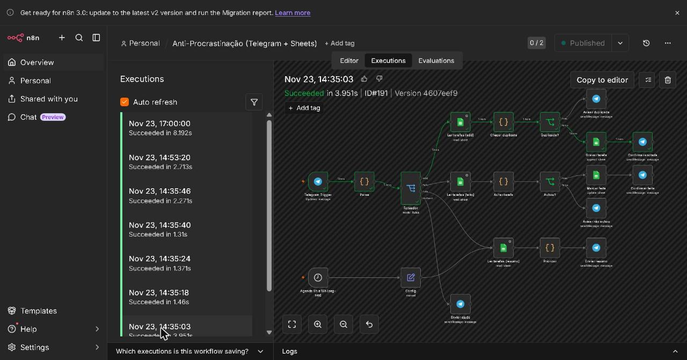
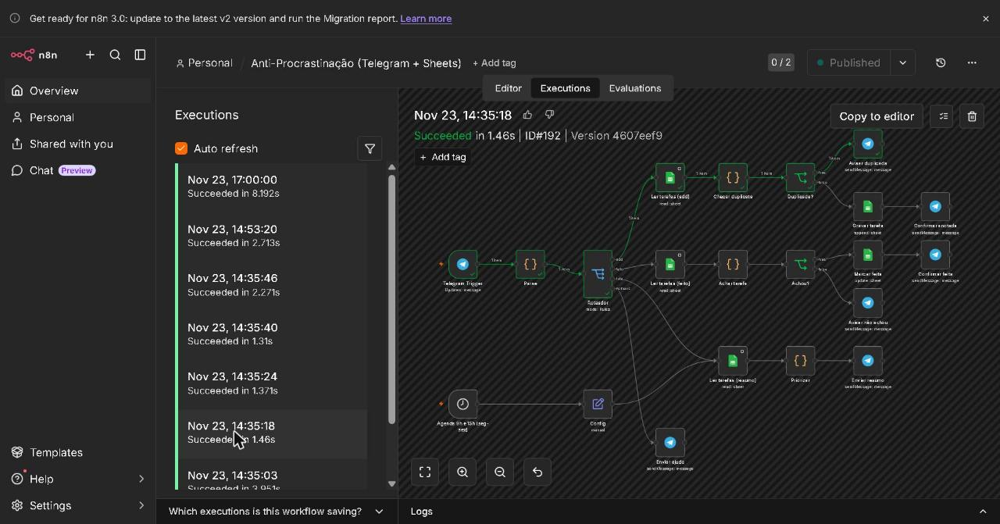
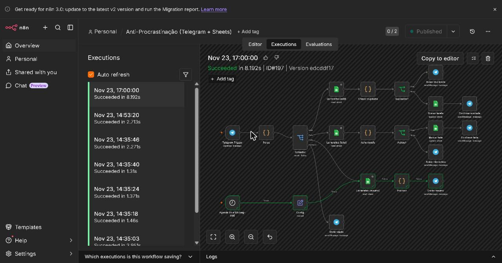
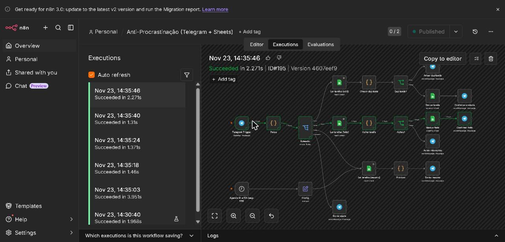

# Mais Produtividade N8N: Anti-Procrastinação (Telegram + Google Sheets)

Atividade: criar um fluxo de automação que resolva um problema pessoal, documentá-lo, validar a lógica, deixá-lo funcional e aplicá-lo em produção. O fluxo está **publicado e rodando em produção** no n8n da atividade (`gc-n8n.zncnif.easypanel.host`).

**Entregáveis**
- Print da automação: seção [Prints](#prints) abaixo e pasta `prints/`
- Código de todo o fluxo: `workflow.json` (importável no n8n) e `code/` (lógica dos nós Code)
- Documentação do problema resolvido: este README

## O problema
Pedidos chegam por vários lugares ("pode ver isso pra mim?", "preciso até sexta"), e eu os guardo só de cabeça. O resultado:

1. **Tarefas esquecidas ou duplicadas**: o mesmo pedido volta por outra pessoa e eu nem lembro que já estava na lista.
2. **Falta de prioridade**: tudo parece igual, então eu começo pelo que é mais fácil e não pelo que é mais urgente.
3. **Empurrar com a barriga**: nada me cobra, e o que fica parado só aparece quando já está atrasado.

## A solução
Um fluxo no n8n em que eu mando a tarefa para um bot do Telegram em uma linha. Ele consulta a planilha antes de gravar, e depois me cobra duas vezes por dia.

| Comando no Telegram | O que acontece |
|---|---|
| `/add Enviar relatório \| Dra. Ana \| 25/11 \| alta` | Checa se já existe algo parecido entre as pendentes. Se existir, **avisa e não duplica**. Se não, grava na planilha. Só a tarefa é obrigatória; o prazo padrão é amanhã e a prioridade padrão é média. |
| texto solto (sem `/`) | Vira `/add`. |
| `/feito ab12` | Marca como feita (registra a data de conclusão). Se o id não existir, avisa. |
| `/lista` | Mostra o resumo na hora. |
| Agenda, seg–sex 9h e 15h | Manda o resumo sozinho. |

**O resumo** traz: 🐸 *a tarefa para começar agora, só 5 minutos*, 🔥 as atrasadas, e 📌 o Top 3.
**Score** = prioridade (1–3) + urgência do prazo (atrasada, hoje, amanhã, até 3 dias) + 0,2 por dia parada na lista (máximo 2). Assim, o que eu empurro sobe sozinho na fila.

**Detecção de duplicata:** o texto é normalizado (caixa, acentos, pontuação, palavras vazias) e comparado com as pendentes. É duplicada se a similaridade de Jaccard for ≥ 70%. Exemplo: "enviar RELATORIO do ppp" é igual a "Enviar relatório do PPP".

## Arquitetura (21 nós)
```
Telegram Trigger → Parse → Roteador ┬ add   → Ler tarefas → Checar duplicata → Duplicada? ┬ sim → avisa
                                    │                                                     └ não → Gravar → confirma
                                    ├ feito → Ler tarefas → Achar tarefa → Achou? ┬ sim → Marcar feita → confirma
                                    │                                             └ não → avisa
                                    ├ lista → Ler tarefas (resumo) → Priorizar → Enviar resumo
                                    └ outro → ajuda
Agenda 9h/15h → Config → Ler tarefas (resumo) → Priorizar → Enviar resumo
```
A lógica fica em 4 nós Code (`code/*.js`). O `workflow.json` é gerado por `build_workflow.py` a partir deles.

## Como instalar
1. Crie uma planilha no Google Sheets (o fluxo usa a **primeira aba**, qualquer nome) com o cabeçalho de `planilha-modelo.csv`: `id, tarefa, quem, prazo, prioridade, status, criada_em, concluida_em`.
2. No Telegram, fale com o **@BotFather**, use `/newbot` e guarde o token.
3. No n8n: **Import from file** → `workflow.json`.
4. Crie as credenciais **Telegram API** (token do bot) e **Google Sheets OAuth2**, e selecione-as nos nós.
5. Nos 5 nós do Google Sheets, confira o ID da planilha (o trecho entre `/d/` e `/edit` na URL). O `workflow.json` deste repositório já vem com o ID da planilha do autor; troque pelo da sua.
6. Mande `/start` para o bot, copie o `chat.id` da execução e cole-o no nó **Config** (`COLE_AQUI_SEU_CHAT_ID`).
7. (Recomendado) No **Telegram Trigger**, em *Restrict to Chat IDs*, coloque o seu id, para que só você use o bot.
8. Em **Settings** do workflow, confira o **Timezone** (`America/Sao_Paulo`). Sem isso o n8n usa o fuso padrão da instância e a agenda de 9h/15h dispara na hora errada.
9. Ative o workflow (**Publish**).

## Testes
- Lógica dos nós Code, sem n8n: `node tests/logic.test.js`. Cobre parser, duplicata (igual, parecida, outra e já concluída), `/feito` e priorização, incluindo prazo em `dd/mm/aaaa`.
- Ponta a ponta, no n8n: `/add` novo → grava; `/add` parecido → avisa duplicada; `/lista` → resumo; `/feito id` → marca; `/feito zzz` → "não achei".

## Limites conhecidos
- O id é curto (5 caracteres base36 do horário). A chance de colisão é desprezível para uso pessoal.
- A duplicata compara palavras, não significado: "mandar o laudo" e "enviar o relatório médico" não são detectadas.
- O fluxo lê a planilha inteira a cada comando. Isso funciona bem para algumas centenas de linhas.

## Segurança

No nó **Telegram Trigger**, o campo *Restrict to Chat IDs* deve conter o seu chat ID (descubra enviando `/start` ao bot e abrindo a execução no n8n). Assim só você consegue cadastrar tarefas. O mesmo ID vai no nó **Config** (`chat_id`), usado pelos lembretes agendados.

## Prints

**Adicionar tarefa nova** (caminho verde: Roteador → Ler tarefas → Checar duplicata → não é duplicada → Gravar tarefa → Confirmar):


**Tarefa parecida** (o fluxo avisa e não grava):


**Lembrete agendado** (Agenda → Config → Ler tarefas → Priorizar → Enviar resumo):


**Conversa de teste no Telegram** (`/add`, duplicada, `/lista`, `/feito` com id inexistente e com id válido):


**Execuções com sucesso no n8n:**

